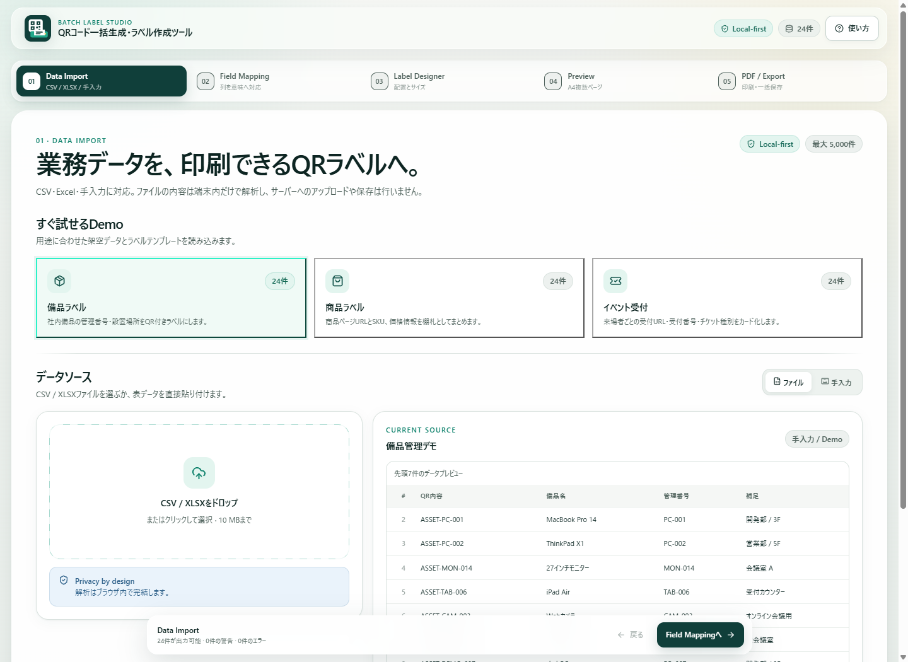
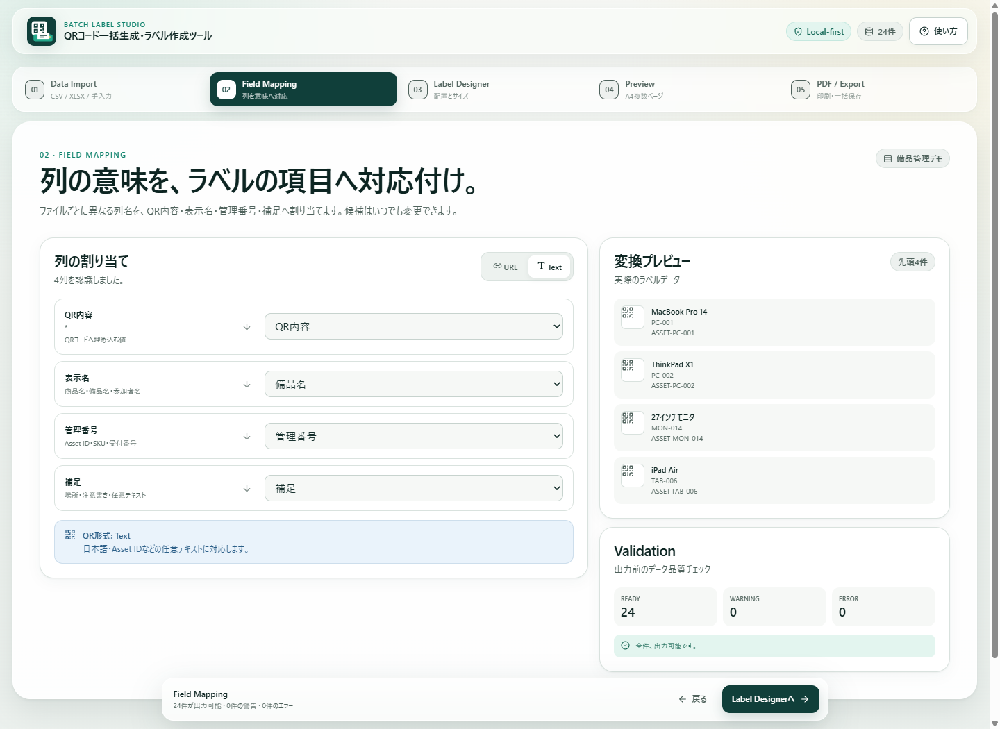
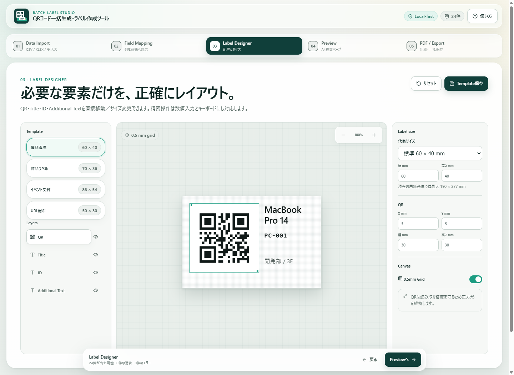
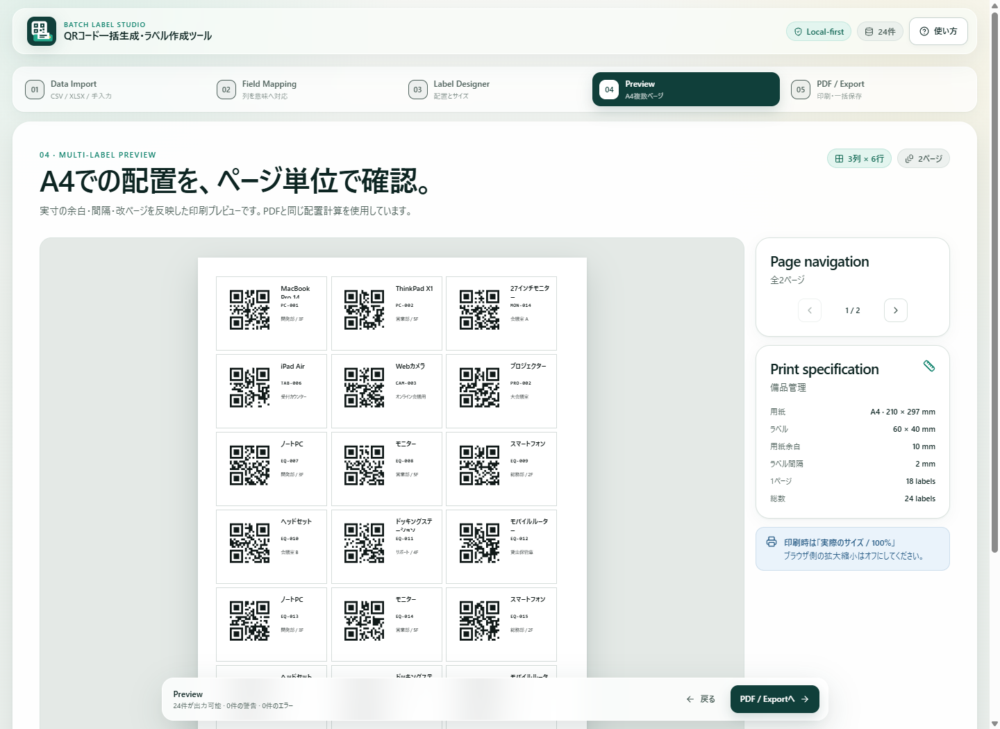
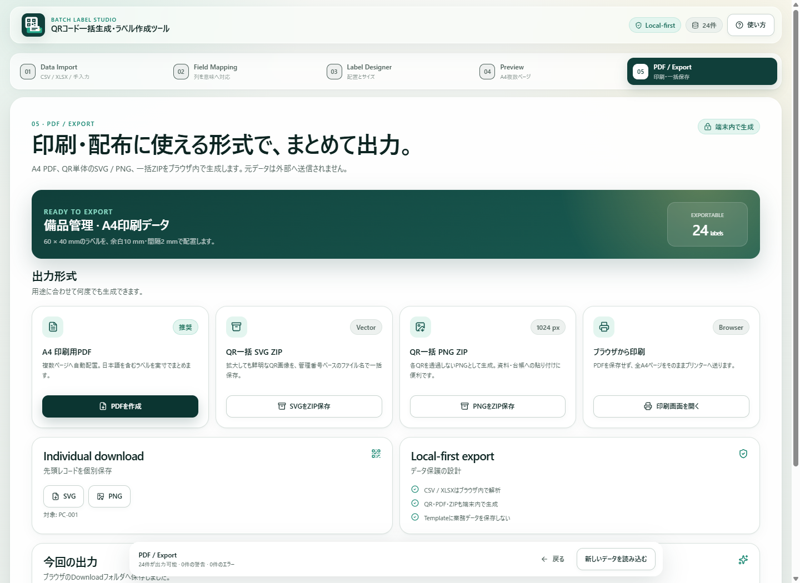

# QRコード一括生成・ラベル作成ツール

CSV / XLSXの業務データを読み込み、列の意味をField Mappingして、QR付きラベルを一括設計・プレビュー・出力するLocal-first Webツールです。

単体のQRコードを作るだけではなく、`Business Data → Mapping → Batch QR → Label Design → Preview → PDF / Print`までの業務フローを一つの画面で完結させます。

- 本番環境: [https://qr-label-batch-generator.vercel.app](https://qr-label-batch-generator.vercel.app)
- GitHub: [https://github.com/shunsoco-stack/qr-label-batch-generator](https://github.com/shunsoco-stack/qr-label-batch-generator)
- カテゴリ: **業務効率化ツール**
- サブカテゴリ: **QR・ラベル生成**

## 想定用途

- 備品管理・資産管理
- 商品ラベル・商品棚札
- イベント受付
- 棚番号・ロケーション管理
- URL配布
- 在庫管理
- 会員証・受付カード

## 主な機能

### 1. Data Import

- CSV、XLSX、手入力に対応
- CSVはUTF-8 / Shift_JIS、カンマ / タブ / セミコロン区切りを判定
- XLSXは利用可能なシートを検出し、表示文字列を保持して読み込み
- ドラッグ&ドロップ、先頭行Header認識、データプレビュー
- 最大5,000件、ファイルサイズ10 MBまで

### 2. Field Mapping

ファイルごとに異なる列名を、次のラベル項目へ割り当てます。

- QR内容（必須）
- 表示名
- 管理番号
- 補足・任意テキスト

QR内容はURL / Textに対応しています。一般的な列名から初期候補を推定し、手動で変更できます。

### 3. Validation / Duplicate Check

- QR内容の空欄チェック
- URLモード時のURL形式、http / httpsプロトコル検証
- QR内容の最大2,048 UTF-8バイト検証
- 表示名、管理番号、補足の文字数警告
- 同一QR内容の重複を行番号付きで警告
- エラー行を印刷・ダウンロード対象から自動除外

### 4. Batch QR / Label Designer

- 数百件規模を想定した一括QR生成
- QR / Title / ID / Additional Textを直接移動・サイズ変更
- ドラッグ、リサイズハンドル、0.5 mmグリッド、数値入力、キーボード操作
- 表示 / 非表示、文字サイズ、配置揃えの調整
- 代表サイズのPresetと任意の幅・高さに対応

| Preset | サイズ |
| --- | --- |
| コンパクト | 50 × 30 mm |
| 標準 | 60 × 40 mm |
| 棚札 | 70 × 36 mm |
| カード | 86 × 54 mm |

### 5. Template

- 備品管理、商品ラベル、イベント受付、URL配布の組み込みTemplate
- 編集したサイズ・配置・文字設定をブラウザの`localStorage`へ保存
- 保存Templateの再利用・削除
- Templateには業務データを保存しない設計

### 6. Preview / Export

- A4上の列数・行数・ページ数を実寸ベースで自動計算
- 複数ページのラベルをページ送りで確認
- 日本語を含むA4印刷用PDFをブラウザ内で生成
- ブラウザ印刷
- 先頭QRのPNG / SVG個別ダウンロード
- 全QRのPNG / SVGをZIPで一括ダウンロード
- PNGは1,024 px、SVGはベクター形式
- 大量出力時の進捗表示と安全なファイル名生成

## Demo Mode

初回表示から次の3種類を試せます。各Demoは複数ページPreviewを確認できる24件の架空データを収録しています。

1. 備品ラベル — 備品名、管理番号、設置場所
2. 商品ラベル — 商品URL、商品名、SKU、価格情報
3. イベント受付 — 受付URL、参加者名、受付番号、チケット種別

## Local-first

CSV / XLSXの解析、QR生成、A4レイアウト、PDF生成、ZIP圧縮はすべてブラウザ内で実行します。入力ファイルや生成対象の業務データをアプリケーションサーバーへ送信しません。

Vercelには静的サイトとして配信し、業務データの保存APIやデータベースは持ちません。ユーザーが保存したラベルTemplateのみ、そのブラウザの`localStorage`へ保存します。

## 技術構成

- Next.js 16 / App Router / Static Export
- React 19 / TypeScript 5
- SheetJS (`xlsx`) / `encoding-japanese`
- `qrcode`
- jsPDF / JSZip
- Lucide React
- Vitest / Testing Library / ESLint
- Vercel

## ローカル実行

Node.js 22以上を使用します。

```bash
npm install
npm run dev
```

ブラウザで`http://localhost:3000`を開いてください。

本番向け静的ビルドは次のコマンドで生成できます。

```bash
npm run build
```

成果物は`out/`へ出力されます。

## 品質確認

```bash
npm run verify
```

`verify`はLint、型検査、ユニットテスト、Production Buildを順番に実行します。

テストでは次の領域を確認しています。

- CSV: 引用符、改行、区切り文字、UTF-8 / Shift_JIS、異常系
- XLSX: シート選択、表示値、先頭ゼロ、異常系
- Mapping: 列名推定、任意項目、変換結果
- QR: Matrix、SVG、PNG、文字列エスケープ
- Duplicate / Validation: 重複、空欄、不正URL、長文、500件Batch
- PDF / ZIP: A4ページ数、日本語描画、出力形式、ファイル数
- Template: 組み込みTemplate、保存、復元、削除、Version管理
- Label Layout: A4配置、Preset、任意サイズ、境界値

個別に実行する場合は次を使用します。

```bash
npm run lint
npm run typecheck
npm test
npm run build
```

## スクリーンショット

### 1. Data Import



### 2. Field Mapping



### 3. Label Designer



### 4. Multi-label Preview



### 5. PDF / Export



## デザイン方針

Appleのインターフェース設計を参考に、情報量の多い業務画面でも現在地と次の操作が分かる5段階ワークフローに整理しました。半透明のナビゲーション、控えめなモーション、即時フィードバック、キーボード操作、`prefers-reduced-motion`などを取り入れています。

専用アイコンはQR、ラベル、プリンターを一つのシンボルとして表現しています。

## License

[MIT License](LICENSE)
